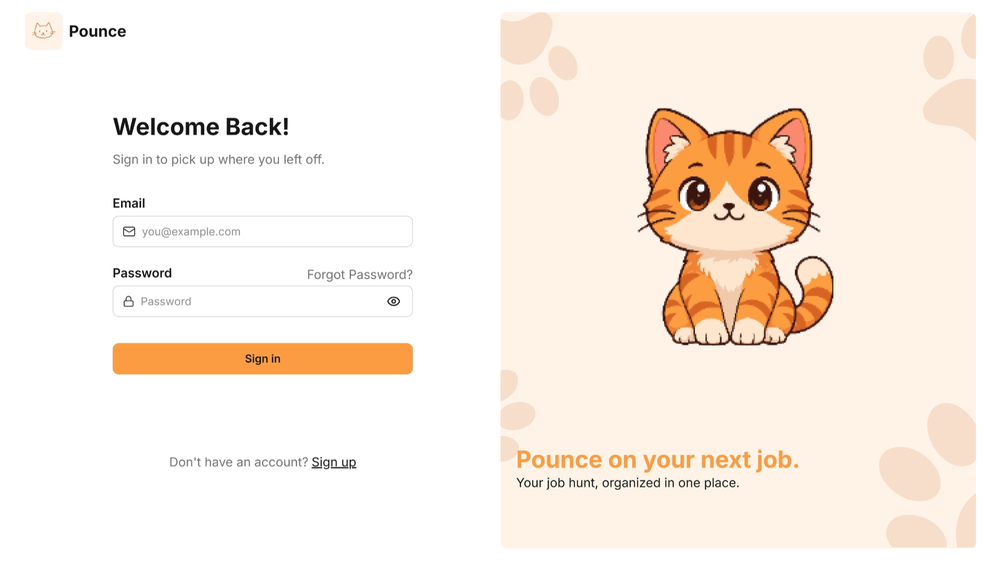

# Pounce 🐱

**Pounce on your next job.** A job application tracker built with the MERN stack, with a cat mascot that reacts to how your job hunt is going.

I built Pounce to replace the Google Sheet I was using to track my own applications. It keeps every company, role, status, and note in one place, and shows where each application stands in the pipeline.

> **Status:** Backend API is complete (auth, per-user data, full CRUD, stats). The React frontend and mascot are in progress.

<!-- Add a screenshot or GIF here once the frontend is ready -->
<!--  -->



**Live demo:** _coming soon_

---

## Features

**Done**

- Register and log in with JWT authentication
- Passwords hashed with bcrypt
- Create, read, update, and delete job applications
- Every user only sees and edits their own applications
- Track status through the pipeline: `wishlist`, `applied`, `interview`, `offer`, `hired`, `rejected`, `ghosted`
- Stats endpoint with a count per status for the dashboard
- Server-side validation with clear error messages

**In progress**

- React frontend with a dashboard, application table, and add/edit form
- Search and filter by status
- Cat mascot that changes mood based on your pipeline (excited after an interview, sleepy when you haven't applied in a while)
- Deployment

---

## Tech Stack

| Layer    | Tools                                        |
| -------- | -------------------------------------------- |
| Frontend | React _(in progress)_                        |
| Backend  | Node.js, Express                             |
| Database | MongoDB Atlas, Mongoose                      |
| Auth     | JSON Web Tokens (`jsonwebtoken`), `bcryptjs` |
| Other    | `cors`, `dotenv`, `nodemon`                  |

---

## Project Structure

```
pounce/
├── backend/
│   ├── src/
│   │   ├── config/        # database connection
│   │   ├── controllers/   # request handling logic
│   │   ├── middleware/    # JWT auth (protect)
│   │   ├── models/        # User and Application schemas
│   │   └── routes/        # URL to controller mapping
│   └── server.js
├── frontend/              # React app (in progress)
└── README.md
```

---

## Getting Started

### Prerequisites

- Node.js 20.19 or newer (22 LTS recommended)
- A free [MongoDB Atlas](https://www.mongodb.com/atlas) cluster (or a local MongoDB)

### Run the backend

```bash
git clone https://github.com/YOUR-USERNAME/pounce.git
cd pounce/backend
npm install
```

Create a `.env` file inside `backend/`:

```
PORT=5000
MONGO_URI=mongodb+srv://<username>:<password>@<cluster>.mongodb.net/pounce?retryWrites=true&w=majority
JWT_SECRET=a-long-random-string
JWT_EXPIRES_IN=7d
```

Generate a secure secret with:

```bash
node -e "console.log(require('crypto').randomBytes(32).toString('hex'))"
```

Then start the server:

```bash
npm run dev
```

The API runs at `http://localhost:5000`.

---

## API Reference

Base URL: `/api`

### Auth

| Method | Endpoint         | Description                                           |
| ------ | ---------------- | ----------------------------------------------------- |
| POST   | `/auth/register` | Create an account. Body: `name`, `email`, `password`. |
| POST   | `/auth/login`    | Log in. Body: `email`, `password`. Returns a token.   |

Both return:

```json
{
  "token": "<jwt>",
  "user": { "id": "...", "name": "...", "email": "..." }
}
```

### Applications

All application routes require the header `Authorization: Bearer <token>`.

| Method | Endpoint              | Description                          |
| ------ | --------------------- | ------------------------------------ |
| GET    | `/applications`       | List your applications, newest first |
| POST   | `/applications`       | Create an application                |
| GET    | `/applications/stats` | Total count and count per status     |
| GET    | `/applications/:id`   | Get one application                  |
| PATCH  | `/applications/:id`   | Update only the fields you send      |
| DELETE | `/applications/:id`   | Delete an application                |

**Example: create an application**

```http
POST /api/applications
Authorization: Bearer <token>
Content-Type: application/json

{
  "company": "Acme Corp",
  "jobTitle": "Junior Web Developer",
  "platform": "LinkedIn",
  "workType": "remote",
  "notes": "Applied through Easy Apply"
}
```

**Example: stats response**

```json
{
  "total": 5,
  "byStatus": {
    "wishlist": 1,
    "applied": 2,
    "interview": 1,
    "offer": 1,
    "hired": 0,
    "rejected": 0,
    "ghosted": 0
  }
}
```

### Application fields

| Field         | Type   | Notes                                                                           |
| ------------- | ------ | ------------------------------------------------------------------------------- |
| `company`     | String | Required. Company or employer name                                              |
| `jobTitle`    | String | Required                                                                        |
| `platform`    | String | Required. Where you found the job (LinkedIn, OnlineJobs.ph, email, referral...) |
| `status`      | String | One of the statuses above. Defaults to `applied`                                |
| `dateApplied` | Date   | Optional                                                                        |
| `workType`    | String | `onsite`, `hybrid`, or `remote`                                                 |
| `location`    | String | Optional                                                                        |
| `salaryRange` | String | Optional, free text                                                             |
| `jobLink`     | String | Optional                                                                        |
| `contact`     | String | Optional. Recruiter name, email, or number                                      |
| `notes`       | String | Optional                                                                        |

### Error responses

Auth and Application endpoints return JSON with a message and a matching status code:

| Code | Meaning                                                                    |
| ---- | -------------------------------------------------------------------------- |
| 400  | Validation failed, invalid id, or duplicate email                          |
| 401  | Missing, invalid, or expired token, or wrong login credentials             |
| 404  | Application not found (including applications that belong to someone else) |
| 500  | Unexpected server error                                                    |

---

## Design Decisions

- **Ownership on every query.** Each application stores its owner, and every read, update, and delete filters by the logged-in user. Requesting someone else's application returns a 404, so ids can't be probed.
- **The client can't set the owner.** The `user` field is ignored in request bodies and always taken from the verified token.
- **Passwords never leave the server.** They are hashed before saving, excluded from queries by default, and left out of every response.
- **Same message for failed logins.** Wrong email and wrong password both return "Invalid email or password", so the API doesn't reveal which emails have accounts.
- **Blank fields are dropped.** Empty form inputs are not stored, and clearing a field on update removes it.

---

## Roadmap

- [x] Express server and MongoDB connection
- [x] Application model and CRUD endpoints
- [x] User model, register, and login
- [x] JWT middleware and per-user data
- [x] Stats endpoint
- [ ] React frontend (dashboard, list, add/edit form)
- [ ] Search and filter
- [ ] Mascot with mood states
- [ ] Deployment (Vercel, Render, MongoDB Atlas)
- [ ] Tests

---

## Author

**Your Name**
[GitHub](https://github.com/benzbarquilla) · [LinkedIn](https://linkedin.com/in/your-profile)
